<p align="center">
  
</p>

<h1 align="center">Mula</h1>

<p align="center">
  Your money, written down as it happens.<br/>
  A private budgeting app that turns your bank's SMS alerts into a review inbox.
</p>

<p align="center">
  <a href="../../releases/latest"></a>
  
  
  <a href="LICENSE"></a>
</p>

<p align="center">
  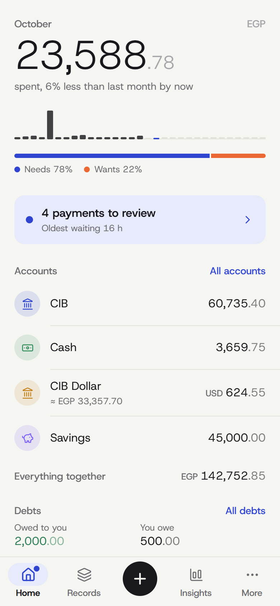
  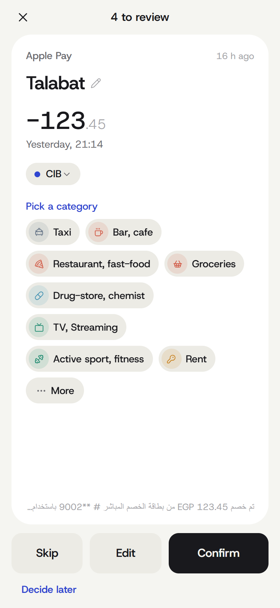
  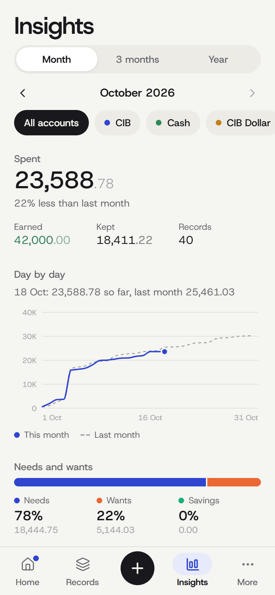
  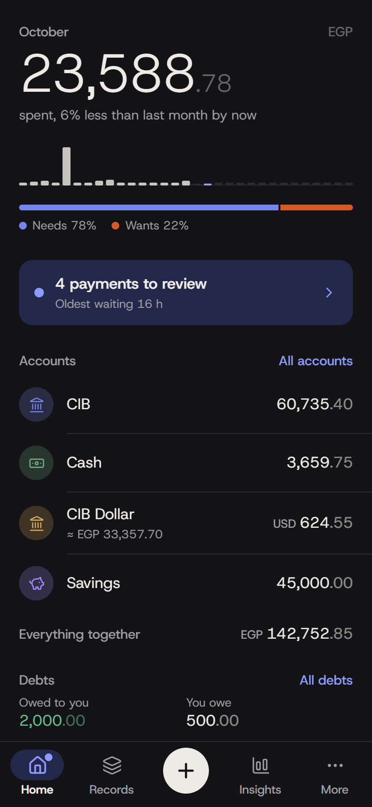
</p>

> [!IMPORTANT]
> **Mula reads CIB (Egypt) SMS alerts out of the box.** Everything else (manual entry, planned payments, debts, insights, multi-currency) works with any bank, but automatic capture currently understands CIB's message formats only.
> **Bank with someone else?** Teaching Mula your bank is one file and a few sample messages: see [Add your bank](#add-your-bank). Pull requests are very welcome.

## What it does

Your bank already texts you every payment. Mula reads those texts, fills in the amount, account, merchant and balance, and puts each payment in an inbox. You swipe to confirm, or fix the category first. Cash and everything else you add by hand in a few taps.

**Capture**
- **Bank SMS to inbox.** Card payments, Apple Pay, InstaPay in and out, ATM withdrawals, deposits and refunds are recognized, including foreign-currency charges on a dollar card.
- **iPhone:** a Shortcuts automation hands every bank SMS to Mula in the background, a Wallet automation logs Apple Pay instantly, and a Home Screen and Lock Screen widget shows what's waiting.
- **Android:** Mula reads new bank SMS itself, even while closed, and can notify you. Only messages from your bank's senders are read.
- **Smart matching.** Duplicate deliveries are dropped, card holds reversed minutes later (Uber, DiDi) cancel out, an Apple Pay entry and its SMS merge into one, and a payment you already typed in is linked instead of added twice.
- **Payees learn.** "PAYMOB Sample Coffee Co" becomes "Sample Coffee Co" once, and its usual category and account follow it. Trusted payees can be confirmed automatically.
- **Paste or import.** Paste any bank SMS, or import your whole SMS history from a message export.

**Money**
- **InstaPay fees** are worked out (0.1%, EGP 0.50 to 20) and booked as spending. The tariff is editable.
- **15 currencies**, with daily exchange rates cached for offline use. A USD card charged in EGP is converted and keeps the original amount.
- **Planned payments**: rent, salary, subscriptions. Any schedule, a reminder before it's due, logged automatically or waiting for you to confirm. A subscription can be charged in a different currency than its account.
- **Debts and lending** with repayments, including lending over InstaPay.
- **Templates** for things you log often, **categories** marked as needs or wants, accounts and net worth.
- **Insights**: this month against last, needs against wants, where it went, when you spend, top payees, income against spending, fees paid.

**Yours**
- **Everything stays on your phone.** No account, no ads, no analytics. The only network calls are for exchange rates (no personal data).
- **Backups** to a file, CSV export and import.
- **Optional: ask Claude.** Run your own relay on Cloudflare's free plan and Claude can answer questions about your money and edit anything for you ("move all Uber rides to Taxi"). Every change it makes can be undone in the app. [Set it up](docs/cloud-and-claude.md).
- Light and dark, a calm design, built with Expo and React Native.

## Install

| | |
| --- | --- |
| **iPhone** | Download `Mula-x.y.z.ipa` from [Releases](../../releases/latest) and install it with **[SideStore](https://sidestore.io)** (recommended: free Apple ID, refreshes itself, no paid developer account). [Step-by-step guide](docs/install-ios.md) |
| **Android** (beta) | Download `Mula-x.y.z.apk` from [Releases](../../releases/latest) and open it. Android 7.0 or later. [Step-by-step guide](docs/install-android.md), including the one extra switch Android 13+ needs for SMS. |
| **Try it first** | Run it in a browser or Expo Go: see [Develop](#develop). |

## Set it up in three steps

1. **Add your accounts.** Mula asks on first launch. Put the last 4 digits of your cards and account (as they appear in the SMS) on each account, so messages land in the right one.
2. **Connect your bank messages.**
   - iPhone: create the Shortcuts automation, about two minutes: [docs/shortcuts.md](docs/shortcuts.md). The same steps, with copy buttons, are in the app under **More › Automation**.
   - Android: **More › Automation › Read bank messages**.
3. **Review.** Payments wait in the inbox (and on the widget). Swipe right to confirm. Mula learns your payees as you go.

Optional: [a cloud copy and Claude](docs/cloud-and-claude.md). It takes about ten minutes, everything from the phone. [](https://deploy.workers.cloudflare.com/?url=https://github.com/khaledsharara/mula/tree/relay-deploy)

## Screens

<p align="center">
  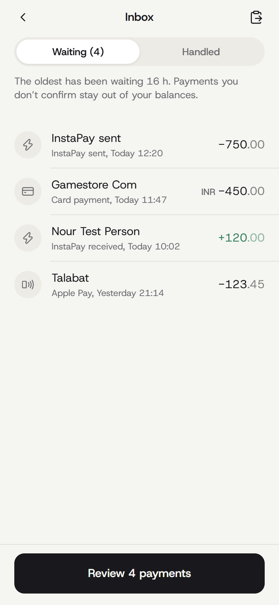
  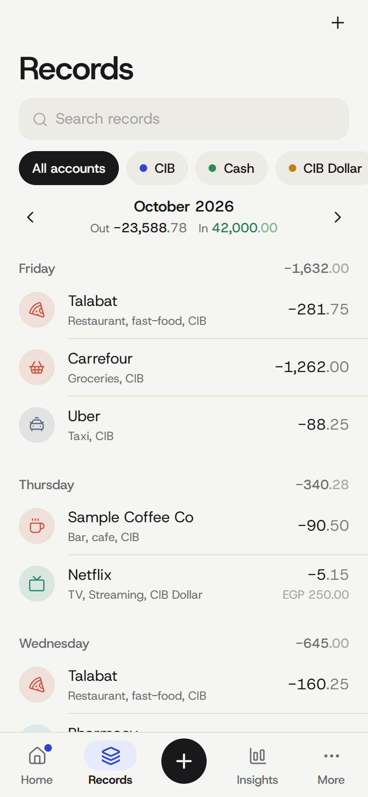
  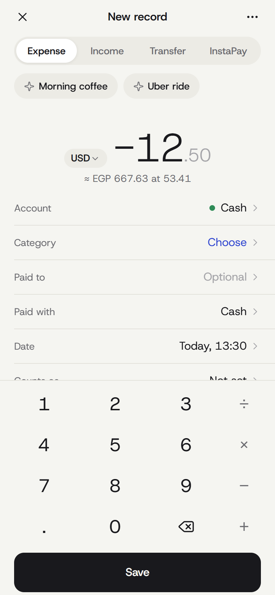
  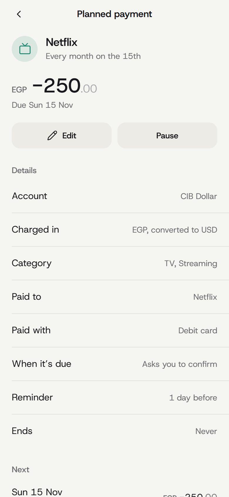
</p>
<p align="center">
  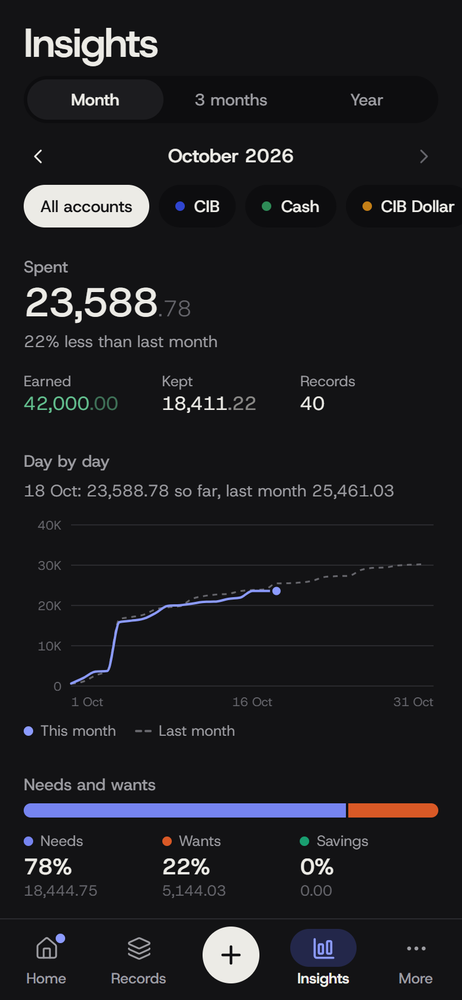
  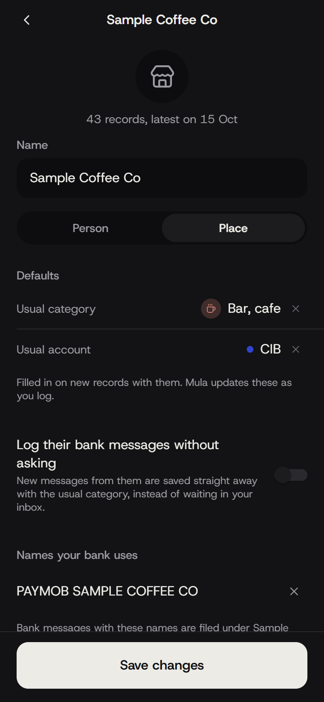
  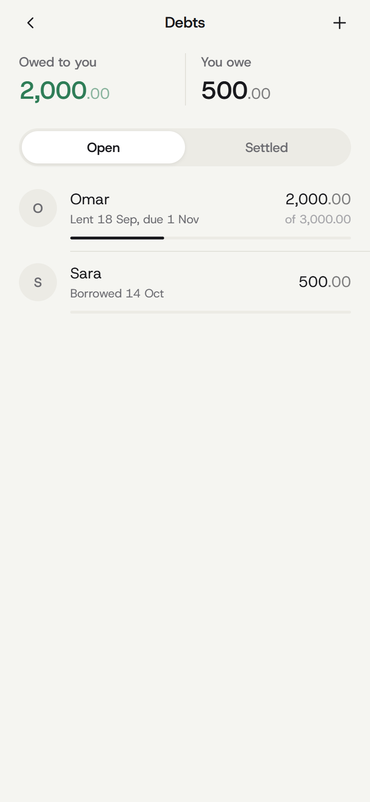
  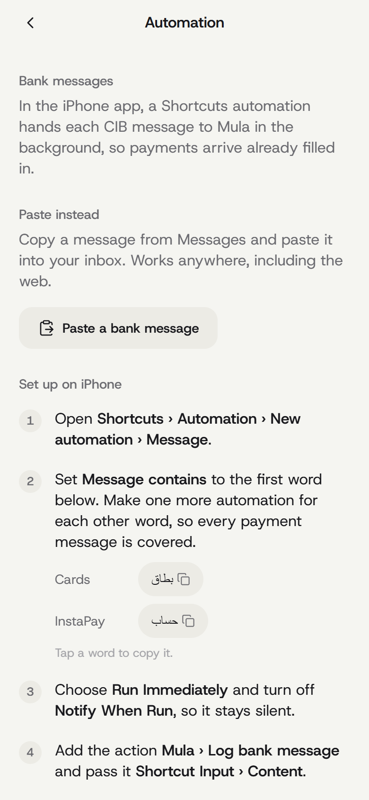
</p>

## Add your bank

Mula's bank knowledge lives in [`src/modules/banks/`](src/modules/banks): one file per bank with its SMS sender names, a regular expression per message format, and the words for the iPhone automation. The inbox, matching, accounts, Shortcuts and Android capture all work for any bank once its definition exists.

To add yours, follow [docs/adding-a-bank.md](docs/adding-a-bank.md). In short: copy `definitions/cib.ts`, write templates for your bank's messages, add made-up sample messages as test fixtures, and open a pull request. The tests check that every template has a sample that matches it.

**Never paste real messages into an issue or pull request.** Replace amounts, card digits, names, branches and reference numbers with made-up ones, and keep the wording.

### Know a better way to get the data?

SMS is a workaround: Egyptian banks don't offer a personal API today. If you know of a better source (an official or open-banking API, account statements by email, app notifications, an aggregator that covers your bank), please [open a data source idea](../../issues/new?template=data-source-idea.yml). Ideas for other countries are welcome too.

## Develop

```bash
npm install
npm start            # Expo Go (the widget, Shortcuts actions and Android capture need the installed app)
npm run web          # the same app in a browser at http://localhost:8081
```

```bash
npm run typecheck && npx expo lint && npm test   # what CI runs on every pull request
npm run e2e                                      # browser suite against the running dev server
cd relay && npm run dev                          # the relay locally (copy .dev.vars.example to .dev.vars)
```

More in [CONTRIBUTING.md](CONTRIBUTING.md) and [docs/architecture.md](docs/architecture.md). Releases are built by GitHub Actions: tag `vX.Y.Z` and [release.yml](.github/workflows/release.yml) builds the IPA and the APK.

## Privacy and security

- Your data is in an SQLite database on your phone. Backups are files you keep.
- On Android, Mula reads SMS only from the bank senders listed under **More › Automation**. Other messages are not read into the app or stored.
- The cloud copy is opt-in and runs in **your own** Cloudflare account. It is protected by a token you create and a password you choose, and **Erase cloud copy** deletes it.
- Releases are built in the open by GitHub Actions from this repository, and the build fails if any personal relay setting would be included.
- Found a problem? Please open an issue without personal data, or a private security advisory for anything sensitive.

## License

[MIT](LICENSE). Mula is not affiliated with CIB, InstaPay, Apple, Google, Anthropic or Cloudflare.
