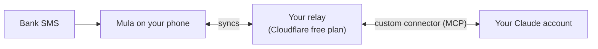

<p align="center">
  
</p>

<h1 align="center">Mula</h1>

<p align="center">
  <b>Your bank texts you every payment. Mula turns those texts into a budget,<br/>and connects it to your own Claude account so you can talk to your money.</b>
</p>

<p align="center">
  <a href="../../releases/latest"></a>
  
  
  
  <a href="LICENSE"></a>
</p>

- **Ask Claude about your money, and let it do the bookkeeping.** Mula plugs into **your personal Claude account** as a custom connector. *"How much did I spend on food this month compared with last?"*, *"Go through my review inbox"*, *"Move all my Uber rides to Taxi"*. Claude reads and edits your real data, and every change it makes can be undone in the app. [See how](#claude-connected-to-your-money)
- **Bank SMS become transactions on their own.** Card payments, Apple Pay, InstaPay, ATM, deposits and refunds arrive already filled in (amount, account, merchant, balance) and wait in an inbox for a swipe. iPhone uses a Shortcuts automation; Android reads the SMS directly. [See how](#bank-sms-captured-automatically)

<p align="center">
  
  
  
  
</p>

> [!IMPORTANT]
> **Automatic SMS capture currently understands CIB (Egypt) only.** Everything else works with any bank. Banking somewhere else? Teaching Mula your bank is one file and a few sample messages: [add your bank](#add-your-bank). Pull requests are very welcome.

## Claude, connected to your money

Mula gives Claude a connector to your budget. You add it once in your own Claude account (**Settings › Connectors**), and from then on, in any chat, on the web or in the Claude apps, Claude can answer questions about your spending and make changes for you: add and edit transactions, work through the review inbox, rename payees, re-categorize, plan payments, track debts.

**An example** (made-up data):

> **You:** How did my food spending this month compare with last month?
>
> **Claude:** So far in October you've spent EGP 6,240 on Food & Drinks, against EGP 7,910 by the same day in September, 21% less. Most of the drop is restaurants: 9 Talabat orders this month against 14. Groceries are about the same.
>
> **You:** Nice. Go through my review inbox.
>
> **Claude:** There are 4 payments waiting. I confirmed Talabat (EGP 123.45, Restaurant), the INR 450 charge on your dollar card (Gamestore, Software, apps, games) and the InstaPay from Nour (+EGP 120). The InstaPay you sent this afternoon (EGP 750) doesn't say who received it. Who was it?
>
> **You:** Omar, my share of dinner. Also add Netflix as a planned payment: 250 EGP on my dollar card, monthly on the 15th.
>
> **Claude:** Done. The EGP 750 to Omar is under Restaurant, fast-food, with the EGP 0.75 InstaPay fee as its own expense. Netflix is planned monthly from 15 November, charged in EGP and converted to USD on your dollar card. Both changes are listed in Mula under Claude's changes, where you can undo them.

**How it fits together:**



The relay is a tiny server in **your own** Cloudflare account (free) that keeps a copy of your data in sync with the phone and serves Claude's connector. No one else hosts your data, and nothing is shared with us.

**Set it up in about ten minutes, from your phone:**

1. In Mula: **More › Automation › Claude › Create a token**. It's copied for you.
2. Deploy your relay: [](https://deploy.workers.cloudflare.com/?url=https://github.com/khaledsharara/mula/tree/relay-deploy)<br/>Paste the token as `APP_TOKEN`, choose a password as `OWNER_PASSWORD`, then copy your relay's address.
3. Back in Mula: paste the address and tap **Connect**. Your data uploads.
4. In Claude: **Settings › Connectors › Add custom connector**, name it `Mula`, and paste your relay address followed by `/mcp` (Mula has a **Copy** button for it). Approve with your password.

Then ask away. **You stay in control:** every change Claude makes appears under **Claude's changes** with **Undo**. **Sign Claude out** revokes its access, and **Erase cloud copy** deletes the relay's data.

Full walkthrough, alternatives (GitHub Actions, command line) and troubleshooting: **[docs/cloud-and-claude.md](docs/cloud-and-claude.md)**. Custom connectors depend on your Claude plan.

## Bank SMS, captured automatically

| | How | Setup |
| --- | --- | --- |
| **iPhone** | A Shortcuts automation hands each bank SMS to Mula in the background. Apple Pay can also log instantly through a Wallet automation. A Home Screen and Lock Screen widget shows what's waiting. | About two minutes: [docs/shortcuts.md](docs/shortcuts.md), also in the app with copy buttons |
| **Android** | Mula reads new SMS from your bank's senders, even while closed, and can notify you. Other messages are never read or stored. | **More › Automation › Read bank messages** ([one extra switch on Android 13+](docs/install-android.md)) |
| **Anywhere** | Paste any bank SMS into the inbox, or import your SMS history from a CSV export. | |

Then Mula does the tidying: duplicate deliveries are dropped, card holds reversed minutes later (Uber, DiDi) cancel out, an Apple Pay entry and its SMS merge, and a payment you already typed in is linked instead of added twice. Payees are learned once ("PAYMOB Sample Coffee Co" becomes "Sample Coffee Co", with its usual category), and trusted ones can be confirmed automatically.

## Also in the box

- **InstaPay fees** worked out and booked as spending (0.1%, EGP 0.50 to 20; editable).
- **15 currencies** with daily rates cached offline. A USD card charged in EGP keeps both amounts.
- **Planned payments** (rent, salary, subscriptions) with reminders, logged automatically or waiting for you. They can be charged in another currency than their account.
- **Debts and lending**, **templates**, **needs vs wants**, net worth, and **insights**: this month against last, where it went, when you spend, top payees.
- **Private by default:** data lives on your phone, with no account, no ads and no analytics. Backups go to files, with CSV export and import. Light and dark themes.

<p align="center">
  
  
  
  
</p>

## Install

| | |
| --- | --- |
| **iPhone** | Download `Mula-x.y.z.ipa` from [Releases](../../releases/latest) and install it with **[SideStore](https://sidestore.io)** (recommended: free Apple ID, refreshes itself, no paid developer account). [Step-by-step guide](docs/install-ios.md) |
| **Android** (beta) | Download `Mula-x.y.z.apk` from [Releases](../../releases/latest) and open it. Android 7.0 or later. [Step-by-step guide](docs/install-android.md) |

On first launch, add your accounts with the last 4 digits of your cards and account as they appear in the SMS, so messages land in the right one. Then connect your bank messages (above) and, if you like, Claude.

## Add your bank

Mula's bank knowledge lives in [`src/modules/banks/`](src/modules/banks): one file per bank, with its SMS sender names, a pattern for each message format, and the keywords for the iPhone automation. Everything else (inbox, matching, accounts, Shortcuts, Android capture, Claude) works for any bank once its definition exists. The guide is [docs/adding-a-bank.md](docs/adding-a-bank.md), and the tests check every pattern against your sample messages.

**Never paste real messages into an issue or pull request.** Replace the amounts, digits, names, branches and reference numbers with made-up ones, and keep the wording.

**Know a better way to get the data?** SMS is a workaround: Egyptian banks don't offer personal APIs today. If you know an API, open-banking aggregator, email alerts or anything else that could feed Mula, for any bank or country, please [share a data source idea](../../issues/new?template=data-source-idea.yml).

## Develop

```bash
npm install
npm run web          # the app in a browser at http://localhost:8081 (or `npm start` for Expo Go)
npm run typecheck && npx expo lint && npm test   # what CI runs on every pull request
```

See [CONTRIBUTING.md](CONTRIBUTING.md) and [docs/architecture.md](docs/architecture.md). Tagging `vX.Y.Z` makes [release.yml](.github/workflows/release.yml) build the IPA and the APK in the open; public builds fail if any personal relay setting would be included.

## License

[MIT](LICENSE). Mula is an independent project, not affiliated with CIB, InstaPay, Apple, Google, Anthropic or Cloudflare.
